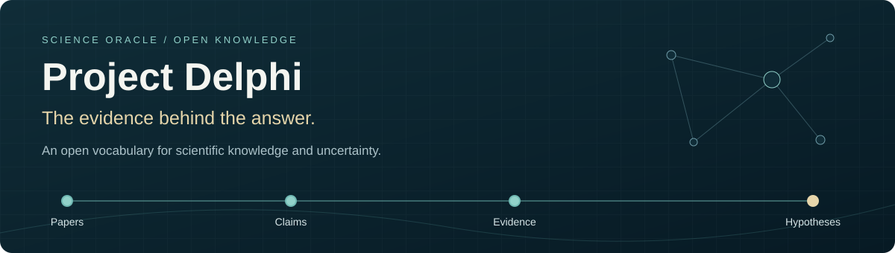

  <a href="https://scienceoracle.com"><strong>Explore Science Oracle</strong></a> &nbsp; · &nbsp;
  <a href="https://scienceoracle.com/graph">Browse the graph</a> &nbsp; · &nbsp;
  <a href="ONTOLOGY.md">Ontology reference</a> &nbsp; · &nbsp;
  <a href="pipeline/README.md">Build &amp; publish</a>

---

Project Delphi organizes scientific research into a **probabilistic knowledge graph (PKG)**: a connected map of claims, evidence, hypotheses, and assessments of uncertainty. The goal is to make it easier to ask what the evidence supports, find disagreements, and trace an answer back to its sources.

Formerly branded **ProbKnow**, this repository contains the shared vocabulary, nanopublication examples, and export pipeline behind that knowledge model. It is not the complete Delphi web application or a download of its entire research database.

<a href="#explore-the-research-dataset">Dataset</a> · <a href="#which-research-areas-are-included">Research areas</a> · <a href="#why-this-knowledge-graph-exists">Purpose</a> · <a href="#what-is-an-ontology-and-what-is-in-this-repository">Repository guide</a> · <a href="#technical-reference">Technical reference</a>

## Explore the research dataset

**Browse the application at [Science Oracle](https://scienceoracle.com)**: ask source-linked questions, [explore the graph](https://scienceoracle.com/graph), inspect [papers](https://scienceoracle.com/papers), and compare [hypotheses](https://scienceoracle.com/hypotheses).

<strong>What lives in the app, this repository, and the publication network?</strong>

There are three related but different collections:

- **The application dataset:** the changing collection of source papers, extracted claims, concepts, hypotheses, evidence assessments, and associated research records available through Science Oracle. Public views do not constitute an export of private research.
- **This ontology repository:** the vocabulary, construction/signing code, queries, templates, tests, and a small set of worked examples. Cloning it does **not** download the application dataset.
- **Published nanopublications:** records actually released to the nanopublication network. Not every application record has been exported, signed, or published. The repository's publication manifest documents its Space/template publications, not a complete catalogue of every application claim.

### What kinds of data are represented?

**Sources & concepts → claims & hypotheses → evidence & assessments**

The model also includes testable hypotheses, evaluating models, economic predictions, and research domains.

<strong>Explore all 12 record types and their meanings</strong>

The vocabulary covers more than claims and confidence scores. Fields are optional where the source or assessment does not supply them; an available term does not mean every record has that information.

| Record type | What it represents |
| --- | --- |
| Papers (pk:Paper) | Source works, bibliographic identifiers and links used to trace claims back to research. |
| Concepts (pk:Concept) | Entities, methods and scientific terms that connect findings across papers. |
| Claims (pk:Claim) | Individual reported propositions, with source-paper links, experimental context, evidence links and assessments where available. A claim is not automatically an established fact. |
| Hypotheses (pk:Hypothesis) | Research propositions or claim clusters, including broader/narrower relationships and associated assessments. |
| Testable hypotheses (pk:TestableHypothesis) | Hypotheses with proposed tests, prior probabilities and resolvability information where supplied. |
| Evidence items (pk:EvidenceItem) | Evidence associated with a claim or assessment, including statistical-test descriptions, p-values, Bayes factors or bounds where available. |
| Assessments (pk:Assessment) | Evaluations kept separate from the proposition evaluated, with verdicts, probabilities, confidence, reasons and assessor attribution as applicable. |
| Bayesian assessments (pk:BayesianAssessment) | Assessments with explicitly represented Bayesian evidence and calibration information. |
| Model assessments (pk:LLMClaimAssessment) | Language-model evaluations; agreement between models is not independent experimental replication. |
| Models (pk:Model) | Evaluating software agents and their identities/versions. |
| Economic predictions (pk:EconomicPrediction) | Market-size and time-to-achievement forecasts linked to hypotheses. These are forecasts, not scientific evidence; market-size units are USD billions. |
| Domains (pk:Domain) | Topic identifiers used to organize and query the research collection. |

Relationships and metadata also record derivation, supporting and opposing points, attribution, dates, licenses, and publication history. See [ONTOLOGY.md](ONTOLOGY.md) for exact properties and [probknow.ttl](probknow.ttl) for their machine-readable definitions. Application-specific features may extend beyond this vocabulary; this README does not assert a complete RDF mapping for every app record.

### Which research areas are included?

The [public domain index](https://scienceoracle.com/api/domains) returned **893 domain labels on 11 October 2026**. This is a dated index snapshot, not 893 equally populated or independently validated disciplines. Discovery adds topics over time, and coverage varies substantially by topic.

**Biology and cognition**  
Levin Lab bioelectricity research, active inference, programmable synthetic biology, biological computing and cell circuits.

**Molecular engineering and biomedicine**  
Protein design, computational antibody design, DNA origami drug delivery, spatial omics, single-cell proteomics and gene delivery.

**Mathematics and applications**  
Graph theory, network structure, molecular simulation, financial models, optimization and related applied mathematics; 494 labels in the snapshot use the math- prefix.

**Semiconductors and computing**  
GaN and SiC devices, ferroelectric memory, RISC-V processors, chiplets, superconducting logic and neuromorphic computing.

**Photonics and quantum science**  
Silicon photonics, co-packaged optics, quantum error correction, quantum communication, spin qubits and single-photon devices.

**Energy, electrochemistry and climate technologies**  
Batteries, electrolyzers, CO2 conversion, carbon capture, desalination and recycling; 120 labels in the snapshot use the electrochemical- prefix.

**Robotics, sensors and manufacturing**  
Robotic grasping, surgical robots, MEMS, lidar, biosensors, additive manufacturing and advanced materials.

These groupings summarize the breadth rather than replace the full list. **Use the [complete current public domain index](https://scienceoracle.com/api/domains) for all public labels**, and select a domain in the graph or paper browser to inspect its records. For example: [Levin Lab](https://scienceoracle.com/graph?domain=levin-lab), [synthetic biology](https://scienceoracle.com/graph?domain=programmable-synth-bio), or [silicon photonics](https://scienceoracle.com/graph?domain=silicon-photonic-co-packaged-optics). The endpoint returns domain labels, not a full claim or paper export.

**Coverage is not validation.** Inclusion does not establish a paper's identity, the accuracy of automated extraction, independent replication, or the truth of a hypothesis. Inspect source identifiers, experimental scope, dependencies and assessment methods. A score should not be read as a calibrated probability unless its method supports that interpretation. New development collections should not be described as publicly available until they appear in the published application.

## Why this knowledge graph exists

**A shared evidence base for understanding science—and deciding what to test next.**

Scientific findings are scattered across papers, datasets, and laboratories. Finding a paper is not the same as knowing what its evidence supports, how it relates to conflicting findings, or which uncertainty is worth investigating next. A fluent AI answer does not solve that problem unless its reasoning can be traced back to evidence.

Delphi's goal is to make that chain inspectable and reusable:

1. **What does the available evidence support?**
2. **Where do findings disagree, or leave important gaps?**
3. **What experiment would most help resolve the uncertainty?**

The graph connects source papers to specific claims, competing hypotheses, and explicit assessments of uncertainty. The ontology in this repository provides the shared vocabulary for those relationships; nanopublications make individual records portable and traceable. The point is not simply to store more research, but to give researchers and agents a common basis for comparing evidence and revising conclusions.

<strong>The longer-term vision: from evidence to experiments</strong>

### The longer-term research loop

The vision is a global, agent-assisted system that connects hypothesis generation to experimental testing: identify promising questions from the evidence, test them through automated wet labs and other experimental systems, and return the results to the shared graph.

~~~mermaid
flowchart TD
    A["Research papers"] --> B["Claims with source provenance"]
    B --> C["Hypotheses and supporting or opposing evidence"]
    C --> D["Evidence assessments and uncertainty"]
    D --> E["Graph exploration and source-linked answers"]
    D -.-> F["Prioritize testable hypotheses"]
    F -.-> G["Design and run experiments"]
    G -.-> H["Publish results with provenance"]
    H -.-> B
~~~

**Solid arrows:** the existing research-ingestion and exploration workflow in the broader Delphi application. **Dashed arrows:** the intended closed-loop extension, including automated experimental execution. This repository supplies the ontology and publication layer; it is not a deployed autonomous laboratory network.

### Why specialized, distributed agents?

Literature discovery, Bayesian reasoning, experiment design, and laboratory automation require different capabilities. A shared evidence model lets specialized agents and participating laboratories contribute to the same research process without requiring every agent to perform every task or every lab to use identical internal tools.

The intended benefit is coordination around explicit, revisable evidence rather than disconnected agent outputs. Findings can be exchanged with their provenance, disagreements can remain visible, and subsequent experiments can target unresolved questions. Human scrutiny and experimental validation remain necessary.

This makes the research more accessible to **researchers** comparing findings, **laboratories and agent developers** coordinating work, **investors and research funders** examining the evidence behind frontier-science opportunities, and **the public** seeking source-linked explanations. Commercial forecasts remain distinct from scientific evidence.

## A short guide to the ideas

<strong>Knowledge graphs, nanopublications, and how the workflow fits together</strong>

## What is a PKG?

A **knowledge graph** represents information as things and relationships between them. In a research graph, a paper reports a claim; that claim may support or challenge a hypothesis; another paper may test the same idea under different conditions.

**Probabilistic** means the graph can represent uncertainty rather than treating every statement as an established fact. It records assessments alongside the claims and evidence they concern, so readers can distinguish a reported finding from an interpretation or a model's estimate.

For example, imagine a paper reports that a treatment improved an outcome in mice. The graph can keep track of:

- what was measured, in which organism, and under what conditions;
- the paper that reported it;
- the broader hypothesis it might support;
- other findings that agree or disagree;
- how the evidence was assessed, and by whom or by which model.

That does **not** establish that the treatment works in humans. Keeping those distinctions visible is part of the point. This is an illustrative example, not a medical claim or a record from this repository.

## How does it work?

1. **Start with research sources.** Papers provide the material and source references.
2. **Extract specific claims.** Findings are represented separately, preserving their context and connection to the source. Automated extraction can make mistakes and must remain inspectable.
3. **Connect claims and hypotheses.** Relationships organize what supports an idea, challenges it, or still needs testing.
4. **Attach assessments.** Evidence scores, model evaluations, and probabilistic assessments are represented explicitly, rather than silently replacing the underlying evidence.
5. **Make records reusable.** The export pipeline packages records as nanopublications that other tools can inspect, verify, and query.

In the broader Delphi application, the graph supports research exploration and evidence-grounded answers. This repository documents the **data model and publication layer**, not every application feature.

**A score is not proof.** A model-assigned score is not automatically a calibrated probability that a claim is true. Multiple models agreeing is not independent experimental replication. The source, method, scope, and limitations still matter.

## What is a nanopublication?

A **nanopublication**, or **nanopub**, is a small, structured, machine-readable publication. Rather than replacing a whole paper, it makes a specific claim or research record independently referenceable and reusable, together with information about where it came from.

It has three main content parts, connected by a small structural header:

| Part | Plain-English meaning |
| --- | --- |
| Assertion | What is being stated: a claim, an entity and its properties, or an assessment. |
| Provenance | Where the assertion came from and how it was derived. |
| Publication information | Information about publishing this nanopub, such as creator, date, and license. |
| Head | Links those three parts into one nanopublication. |

The signed examples here also carry a **digital signature** and a **trusty URI**, an identifier containing a hash derived from their content. These allow someone to check integrity and the signing key. They do **not** prove that the scientific claim is correct, that it was peer reviewed, or that the signer is a trustworthy expert.

A published, content-addressed nanopub is not edited in place. A correction is a new publication that can reference or supersede the earlier one, preserving the history.

## Why is this relevant?

- **For researchers:** compare individual findings and their context instead of treating a paper's headline as the whole result.
- **For readers of AI answers:** inspect the evidence behind a statement and distinguish missing evidence from strong support.
- **For developers:** exchange structured records using shared identifiers and standard query tools instead of scraping prose.
- **For open science:** cite, verify, and reuse a small research record outside the application that created it.

The PKG organizes the relationships and uncertainty. Nanopublications make individual records portable and traceable. The ontology gives those records a shared meaning.

## What is an ontology, and what is in this repository?

An **ontology** is a shared vocabulary that defines the kinds of things a system describes and how they relate. Here it defines concepts such as claims, evidence items, hypotheses, and assessments, so different tools can interpret the same data consistently.

| Start here | What it contains |
| --- | --- |
| [Ontology reference](ONTOLOGY.md) | Human-readable definitions of classes, properties, and compatibility mappings. |
| [Ontology source](probknow.ttl) | Machine-readable vocabulary in Turtle, a text format for RDF data. |
| [Examples](examples/) | Signed nanopublications, including illustrative files and earlier published records. |
| [Publication pipeline](pipeline/) | TypeScript code that constructs records and passes them to the signing library. |
| [Queries](queries/) | SPARQL queries: searches over graph data. |
| [Space and templates](nanopubs/) | Network templates and governance records, plus a [publication manifest](nanopubs/published.json). |
| [Identifier redirect rules](w3id/) | Rules and notes for resolving the existing ontology identifiers. |

If you are new to the project, read one [claim example](examples/probknow-claim-entity.example.trig) alongside the [ontology reference](ONTOLOGY.md). You do not need to run the application to read these public files.

---

## Technical reference

<strong>Branding and stable identifiers</strong>

**Project Delphi** is the current project branding. **ProbKnow** remains in existing filenames, namespaces, and published network records for compatibility. The repository rename does not create a new ontology version or change the meaning of existing terms.

- Ontology IRI: `https://w3id.org/probknow/ontology`
- Current version IRI: `https://w3id.org/probknow/ontology/1.1`
- Term namespace: `pk: → https://w3id.org/probknow/ontology/`
- Resource namespace: `pkr: → https://w3id.org/probknow/resource/`

An IRI is a globally unique identifier, usually written like a URL. Declaring one does not by itself guarantee that visiting it returns a document; see [redirect configuration](w3id/). The branding change does not assert that every namespace URL currently resolves.

The ontology reuses PROV-O, SKOS, Dublin Core Terms, CiTO, FaBiO, and the Nanopublication schema where possible. Project-specific terms cover the additional assessment layer.

<strong>Scores and probabilities</strong>

- `pk:weightOfEvidence` is a 0–1 weight-of-evidence score, not a deciban value and not automatically a probability of truth.
- `pk:weightOfEvidenceDeciban` is the separate property for deciban-valued evidence.
- Probability and prior-probability properties describe the corresponding assessment; their interpretation depends on the method and assumptions used.

Consult [ONTOLOGY.md](ONTOLOGY.md) for the exact definitions before combining values across records.

<strong>Examples and publication status</strong>

The three illustrative files below were signed with a throwaway key and are **not published**:

- [Entity claim](examples/probknow-claim-entity.example.trig): one claim with its properties, context, evidence link, and weight.
- [Single-statement claim](examples/probknow-claim-statement.example.trig): the alternative statement-level representation.
- [Publisher introduction](examples/probknow-intro.example.trig): an agent and its key declaration.

Earlier published examples are retained as historical artifacts:

- [MURUGAN2022 claim](examples/levin-claim-MURUGAN2022.trig), [network identifier](https://w3id.org/np/RAzdRzAqBocJKLkN28FmiRA3njB3Yct4qXIU-FPTA6L2Y): uses pk:/pkr: vocabulary but retains some earlier identifiers and metadata conventions. It is **not** byte-identical to current builder output.
- [Levin P1 hypothesis](examples/levin-P1.legacy.trig), [network identifier](https://w3id.org/np/RANokmO9j8qIxyBdirmYlJ_zKFtlQiWgeA86AavxiO-is): uses the older urn: vocabulary.

The [publication manifest](nanopubs/published.json) records the Space, templates, and maintenance declarations published under the ProbKnow identifiers. See [nanopubs/README.md](nanopubs/README.md) for their sources and maintenance workflow; they are not renamed or re-signed as part of the branding update.

<strong>Construction and signing</strong>

The pipeline has two separately inspectable stages:

1. [Construction](pipeline/probknow-builders.ts) assembles assertion, provenance, publication-information, and head graphs.
2. [Sealing](pipeline/seal.ts) delegates content hashing and RSA-SHA256 signing to [@nanopub/nanopub-js](https://github.com/Nanopublication/nanopub-js).

See [pipeline/README.md](pipeline/README.md) for setup, builders, the signing demo, and verification instructions. [reproduce-example.ts](pipeline/reproduce-example.ts) lets readers inspect construction from example inputs. Current builders add metadata and canonicalize legacy identifiers, so differences from an older published record are expected. Recreating its exact hash also requires the original timestamp and signing inputs; no private key is supplied here.

<strong>Backward compatibility</strong>

Published nanopublications are content-addressed and remain unchanged. The ontology includes mappings from earlier urn:pkg:, urn:levin-kg:, example.org/levin-kg/, and version-1.0 hash terms to current pk: terms. See the [legacy-to-canonical crosswalk](ONTOLOGY.md#legacy--canonical-crosswalk).

A store with the appropriate equivalence reasoning can use those mappings; a plain SPARQL endpoint needs explicit query alternatives or normalization. The mappings do not automatically rewrite historical data or enable reasoning on every endpoint. The builders canonicalize supported legacy inputs and reject leftover example.org identifiers.

<strong>Queries</strong>

The [queries directory](queries/) contains:

- [all-probknow-nanopubs.rq](queries/all-probknow-nanopubs.rq): records using the project's terms or resources.
- [claims-by-domain.rq](queries/claims-by-domain.rq): nanopublication counts grouped by research domain.
- [high-confidence-claims.rq](queries/high-confidence-claims.rq): records with high assigned evidence scores; the filename does not imply scientifically proven claims.

Run them against a compatible nanopublication SPARQL endpoint, such as [Nanopub Query](https://query.knowledgepixels.com/) or [the Petapico endpoint](https://virtuoso.nps.petapico.org/sparql). Endpoint availability, indexing, and supported reasoning can vary.

<strong>Contributing</strong>

Useful contributions include clearer definitions, worked examples, query improvements, stronger source-paper links, and compatibility checks. Check the source files and publication manifest before treating an older migration note as current. Changes to signed records require new publications, not edits to their existing content.

<strong>License</strong>

Repository code is covered by the [MIT license](LICENSE). Ontology and nanopublication artifacts may declare their own license metadata, including CC BY 4.0; preserve and consult those declarations when reusing them.

